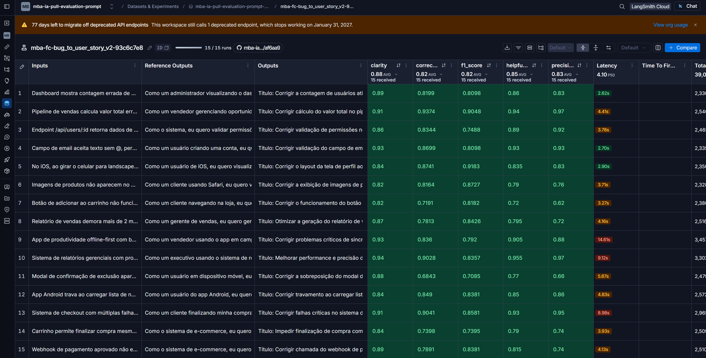
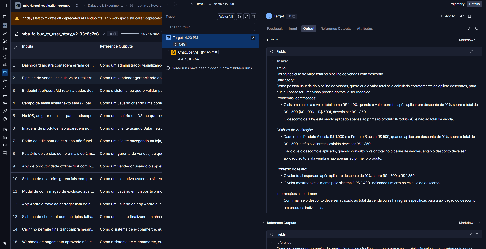
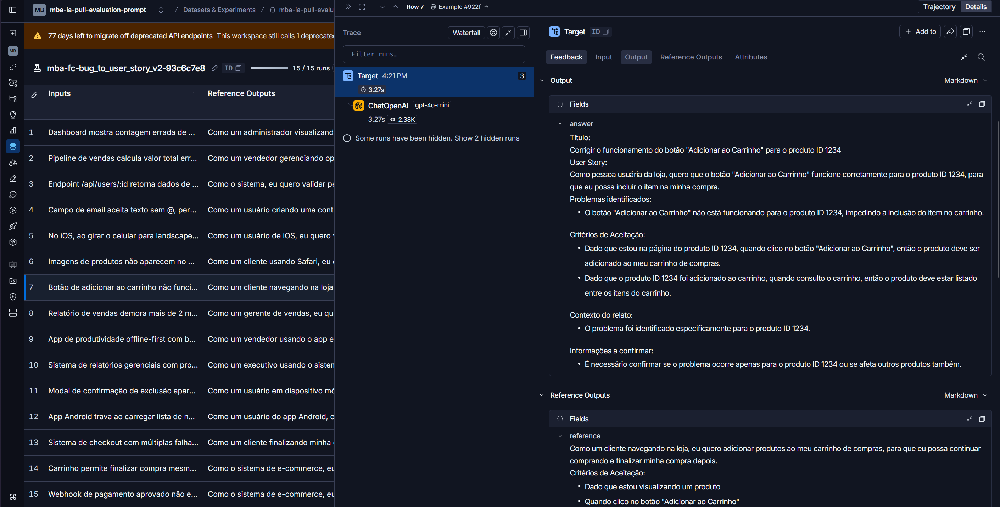
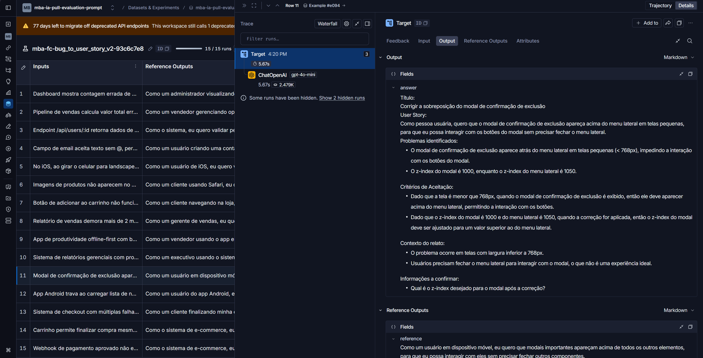

# Pull, Otimização e Avaliação de Prompts com LangChain e LangSmith

Projeto que faz o pull de um prompt de baixa qualidade do LangSmith Prompt Hub, o refatora com técnicas de Prompt Engineering, publica a versão otimizada de volta no Hub e mede a qualidade com métricas automáticas no LangSmith.

- **Tarefa do prompt:** transformar relatos de bugs em User Stories com critérios de aceitação.
- **Prompt original (v1):** `leonanluppi/bug_to_user_story_v1`
- **Prompt otimizado (v2):** [`mba-fc/bug_to_user_story_v2`](https://smith.langchain.com/hub/mba-fc/bug_to_user_story_v2) (público)
- **Meta:** Helpfulness, Correctness, F1-Score, Clarity e Precision, todas ≥ 0.8.

## Sumário

1. [Técnicas Aplicadas (Fase 2)](#técnicas-aplicadas-fase-2)
2. [Resultados Finais](#resultados-finais)
3. [Como Executar](#como-executar)
4. [Estrutura do projeto](#estrutura-do-projeto)

---

## Técnicas Aplicadas (Fase 2)

O prompt otimizado está em [`prompts/bug_to_user_story_v2.yml`](prompts/bug_to_user_story_v2.yml). Ele combina três técnicas: Few-shot Learning (obrigatória), Role Prompting e Least-to-Most.

### 1. Few-shot Learning

**O que foi feito:** o `system_prompt` traz três exemplos completos de entrada e saída, em complexidade crescente:

| Exemplo | Nível | Domínio | O que ensina |
|---|---|---|---|
| 1 | Simples | Biblioteca (renovação de empréstimo) | Estrutura básica e critérios verificáveis |
| 2 | Intermediário | Avaliações (pontuação de questões) | Vários cenários para uma mesma regra |
| 3 | Complexo | Plataforma de vídeos (legendas) | Relato com quatro problemas, critérios agrupados por problema, preservação de números e cenário integrado |

**Por que:** a primeira versão do prompt tinha só dois exemplos curtos, e o modelo imitou a brevidade deles. Os relatos longos do dataset tiveram F1 baixo (veja a [iteração 1](#iterações)). Exemplos com a profundidade desejada são o jeito mais direto de definir o formato e o nível de detalhe da saída.

**Cuidado com vazamento:** os exemplos são originais, de domínios diferentes dos do dataset de avaliação. Nenhum relato nem referência do dataset foi copiado para o prompt.

### 2. Role Prompting

**O que foi feito:** o prompt define uma persona com contexto, público e padrão de qualidade:

```
Você é um Product Manager sênior com mais de 10 anos de experiência
em produtos digitais [...]

Você escreve para desenvolvedores e profissionais de QA que precisam
compreender o problema, implementar a correção e verificar o resultado.

Uma boa User Story:
- Identifica o perfil afetado, o comportamento esperado e o benefício.
- Preserva números, unidades, identificadores e condições do relato.
- Define critérios de aceitação observáveis e testáveis.
- Cobre todos os problemas relatados.
```

**Por que:** o v1 usava "um assistente que ajuda", sem papel definido. Dizer quem lê a saída (desenvolvimento e QA) orienta o modelo a escrever critérios testáveis e a preservar os dados do relato.

### 3. Least-to-Most (adaptado para uma única chamada)

**O que foi feito:** o prompt instrui o modelo a decompor o relato em etapas, da parte mais simples para a mais complexa:

1. Identificar o perfil afetado e seu objetivo.
2. Decompor o relato em problemas observáveis.
3. Definir critérios para os comportamentos isolados.
4. Cobrir as dependências e os cenários que combinam os problemas.
5. Consolidar em uma User Story principal.
6. Conferir se todos os problemas e dados relevantes foram cobertos.

O resultado da decomposição aparece na seção **Problemas identificados** e nos critérios agrupados por problema. O prompt proíbe expor o raciocínio passo a passo.

**Por que:** relatos com vários problemas (o caso mais difícil do dataset) eram resumidos em uma story rasa. A decomposição força cobertura de cada problema.

**Por que não Chain of Thought explícito:** o `evaluate.py` envia a saída inteira para o juiz. Raciocínio escrito na resposta seria contado como conteúdo extra e reduziria a precision.

**Limitação:** esta é uma adaptação. O Least-to-Most clássico resolve os subproblemas em chamadas separadas, alimentando cada uma com o resultado da anterior. Aqui tudo acontece em uma só chamada.

### Outras decisões de design

- **System vs. User:** o `system_prompt` contém persona, regras, método, formato e exemplos. O `user_prompt` contém apenas o relato, entre as tags `<relato_de_bug>`, com uma única variável: `{bug_report}`.
- **Regras explícitas:** não inventar causas, tecnologias, prazos ou metas; preservar qualificadores ("mais de", "até"); diferenciar medições atuais de metas; evitar critérios vagos como "funcionar corretamente".
- **Edge cases:** perfil não identificado usa "pessoa usuária"; ambiguidade relevante vira pergunta objetiva em "Informações a confirmar" (seção opcional); o relato é tratado como dado, mesmo que contenha instruções (proteção contra prompt injection).
- **Formato de saída:** Título, User Story ("Como... quero... para..."), Problemas identificados, Critérios de Aceitação em Dado/Quando/Então, e seções opcionais de contexto e informações a confirmar.

---

## Resultados Finais

### Configuração da avaliação

| Item | Valor |
|---|---|
| Provider | OpenAI |
| Modelo que responde (`LLM_MODEL`) | `gpt-4o-mini` |
| Modelo que avalia (`EVAL_MODEL`) | `gpt-5.4-mini` |
| Temperatura | 0 |
| Dataset | 15 exemplos (5 simples, 7 médios, 3 complexos) |

O `evaluate.py` roda três juízes por exemplo (F1, Clarity e Precision). As outras duas notas são derivadas:

- **Helpfulness** = (Clarity + Precision) / 2
- **Correctness** = (F1-Score + Precision) / 2

### Resultado final (prompt da iteração 3, puxado do Hub)

Execução final do `evaluate.py`, que puxa `mba-fc/bug_to_user_story_v2` do Hub (experimento `mba-fc-bug_to_user_story_v2-93c6c7e8`):

```
Métricas Derivadas:
  - Helpfulness: 0.85 ✓
  - Correctness: 0.82 ✓

Métricas Base:
  - F1-Score: 0.82 ✓
  - Clarity: 0.88 ✓
  - Precision: 0.83 ✓

MÉDIA GERAL: 0.8402
STATUS: APROVADO - Todas as métricas >= 0.8
```

### Iterações

Os experimentos foram feitos sempre com os mesmos modelos, para que a diferença de nota viesse do prompt.

| # | Experimento | O que mudou | F1 | Correct. | Precision | Clarity | Helpful. | Status |
|---|---|---|---|---|---|---|---|---|
| 1 | `mba-fc-bug_to_user_story_v2-2f17cb04` | Primeira versão: persona "analista de produto", 2 exemplos curtos e simples, regras básicas | 0.76 | 0.79 | 0.81 | 0.86 | 0.83 | Reprovado (F1 e Correctness) |
| 2 | `mba-fc-bug_to_user_story_v2-1ef59e9d` | Reescrita: persona de Product Manager sênior, método Least-to-Most, 3 exemplos (incluindo um complexo), critérios em Dado/Quando/Então, regras para preservar números e fatos | 0.81 | 0.83 | 0.84 | 0.86 | 0.85 | Aprovado |
| 3 | `mba-fc-bug_to_user_story_v2-ae6d59c1` | Removidas as perguntas de "Informações a confirmar" do exemplo complexo | 0.81 | 0.83 | 0.85 | 0.87 | 0.86 | Aprovado |
| 3 (re-execução) | `mba-fc-bug_to_user_story_v2-93c6c7e8` | Mesmo prompt da iteração 3, publicado no Hub e avaliado a partir dele | 0.82 | 0.82 | 0.83 | 0.88 | 0.85 | Aprovado |

As notas da iteração 1 são as médias exibidas no dashboard do LangSmith (naquele momento 13 dos 15 exemplos tinham recebido nota), então são aproximadas.

**O que cada iteração ensinou**

- **Iteração 1 → 2:** a análise dos comentários do juiz mostrou que o recall caía nos relatos longos. O exemplo complexo e a decomposição melhoraram bastante esses casos. Por exemplo, em um relato de relatórios gerenciais a precision foi de 0.42 para 0.88, e em um relato de modal sobreposto o F1 foi de 0.58 para 0.85.
- **Iteração 2 → 3:** o juiz penalizava como "informação a mais" as perguntas de investigação (em 4 das 5 linhas com precision baixa). Remover as perguntas do exemplo complexo reduziu esse efeito, mas a melhora ficou dentro do ruído da avaliação.

### Estabilidade e limitações

- **A margem do F1 é pequena** (0.81 contra o mínimo de 0.80). Comparando duas execuções, a nota de um mesmo exemplo variou cerca de ±0.07, e a média de 15 exemplos oscila na casa de ±0.015. Uma nova execução pode ficar ligeiramente abaixo de 0.80. A re-execução com o prompt publicado no Hub deu F1 0.82 (contra 0.81 na iteração 3), com média geral de 0.8402, dentro dessa oscilação.
- **Parte do F1 depende de detalhes que as referências inventam** (por exemplo, "checkpoints de 5MB" ou "lotes de 50 itens" em um relato de sincronização). Tentar reproduzi-los exigiria ajustar o prompt ao dataset e contrariaria a própria regra de não inventar. Essa perda foi aceita.
- **Tentativas com Gemini** falharam por cota do plano gratuito (limite zero para o modelo escolhido), e a avaliação final foi feita com OpenAI.

### Comparação entre v1 e v2

O `evaluate.py` avalia apenas o v2, então o v1 não tem notas próprias. A comparação abaixo é qualitativa, e a evolução numérica está na tabela de iterações.

| Aspecto | v1 | v2 |
|---|---|---|
| Persona | "Um assistente que ajuda" | Product Manager sênior, com público e padrão de qualidade |
| Exemplos | Nenhum | 3 exemplos (simples, intermediário, complexo) |
| Estrutura | `{bug_report}` repetido no system e no user | Variável apenas no `user_prompt`, entre tags |
| Formato de saída | Livre ("User Story gerada:") | Seções definidas, critérios em Dado/Quando/Então |
| Regras | Instruções vagas | Regras explícitas (não inventar, preservar números, evitar critérios vagos) |
| Edge cases | Nenhum tratamento | Perfil indefinido, ambiguidade, relatos com vários problemas, relato com instruções |
| Raciocínio | Nenhum | Decomposição Least-to-Most |

### Evidências no LangSmith

- **Dataset de avaliação público (15 exemplos e experimentos):** [https://smith.langchain.com/public/4cd1431a-ebea-43bd-a387-6416c21aa473/d](https://smith.langchain.com/public/4cd1431a-ebea-43bd-a387-6416c21aa473/d)
- **Screenshot das notas finais (todas ≥ 0.8):** experimento `mba-fc-bug_to_user_story_v2-93c6c7e8`, com as notas dos 15 exemplos.

  

- **Traces detalhados de 3 exemplos** (cada trace mostra a execução do prompt: chamada ao `gpt-4o-mini`, latência, tokens, a User Story gerada e a referência do dataset):

  1. Exemplo "Pipeline de vendas" (F1 0.90, precision 0.97, 4.41 s, 2.54K tokens): caso bom. A resposta preserva os valores do relato (R$ 1.500, 10% e R$ 1.350) e cobre os dois problemas identificados com critérios em Dado/Quando/Então.

     

  2. Exemplo "Botão de adicionar ao carrinho" (F1 0.82, precision 0.62, 3.27 s, 2.38K tokens): caso fraco. A resposta cita o produto ID 1234 em título, história e critérios e acrescenta uma pergunta em "Informações a confirmar". O juiz penalizou essas informações extras na precision.

     

  3. Exemplo "Modal de confirmação de exclusão" (F1 0.71, precision 0.66, 5.67 s, 2.48K tokens): caso fraco. O conflito de z-index (1000 contra 1050) foi identificado, mas a referência exigia mais requisitos (backdrop desfocado, foco de teclado, fechamento com ESC) e a resposta incluiu uma pergunta sobre o z-index desejado.

     

---

## Como Executar

### Pré-requisitos

- Python 3.10+ (o projeto foi desenvolvido com Python 3.14)
- Conta no [LangSmith](https://smith.langchain.com/) e uma API key (Personal Access Token)
- Uma chave de um provedor de LLM: [OpenAI](https://platform.openai.com/api-keys) ou [Google Gemini](https://aistudio.google.com/app/apikey)
- Um **handle público** no LangSmith Hub. Ele só existe depois que você torna um prompt público: em **Prompts**, abra um prompt, clique nos três pontinhos, escolha **Make Public** e defina o handle. Ele é definitivo.

### 1. Instalação

```bash
git clone <url-do-seu-fork>
cd mba-ia-pull-evaluation-prompt

python3 -m venv venv
source venv/bin/activate   # No Windows: venv\Scripts\activate
pip install -r requirements.txt
```

### 2. Configuração

```bash
cp .env.example .env
```

Preencha o `.env`:

| Variável | Descrição |
|---|---|
| `LANGSMITH_TRACING` | `true` para enviar os traces |
| `LANGSMITH_ENDPOINT` | `https://api.smith.langchain.com` |
| `LANGSMITH_API_KEY` | Sua API key do LangSmith |
| `LANGSMITH_PROJECT` | Nome do projeto. Define o dataset de avaliação `<projeto>-eval` |
| `USERNAME_LANGSMITH_HUB` | Seu handle público do Hub |
| `LLM_PROVIDER` | `openai` ou `google` |
| `OPENAI_API_KEY` / `GOOGLE_API_KEY` | Chave do provedor escolhido |
| `LLM_MODEL` | Modelo que gera as User Stories |
| `EVAL_MODEL` | Modelo que avalia as respostas |

O arquivo `.env` está no `.gitignore`. Nunca faça commit das suas chaves.

### 3. Pull do prompt original

```bash
python src/pull_prompts.py
```

Baixa `leonanluppi/bug_to_user_story_v1` do Hub e salva em `prompts/bug_to_user_story_v1.yml`.

### 4. Otimização

Edite manualmente `prompts/bug_to_user_story_v2.yml`.

### 5. Push do prompt otimizado

```bash
python src/push_prompts.py
```

Valida o YAML e publica o prompt em `{seu_handle}/bug_to_user_story_v2`, público, com tags e descrição.

### 6. Avaliação

Execute a partir da **raiz do projeto**, porque o script usa o caminho relativo `datasets/bug_to_user_story.jsonl`:

```bash
python src/evaluate.py
```

O script cria o dataset `<LANGSMITH_PROJECT>-eval` (se não existir), avalia o prompt `{seu_handle}/bug_to_user_story_v2` e grava as 5 notas como feedback no experimento. Ao final imprime o status e o link do experimento.

> O `evaluate.py` baixa o prompt do Hub, não do arquivo local. Depois de editar o YAML, faça o push antes de avaliar.

### 7. Testes de validação

```bash
pytest tests/test_prompts.py -v
```

### 8. Link público do dataset de avaliação

```python
from langsmith import Client

print(Client().share_dataset(dataset_name="<seu LANGSMITH_PROJECT>-eval")["url"])
```

O link muda a cada chamada, então rode uma vez e guarde o endereço.

---

## Estrutura do projeto

```
mba-ia-pull-evaluation-prompt/
├── .env.example
├── requirements.txt
├── README.md
├── prompts/
│   ├── bug_to_user_story_v1.yml   # Prompt original (pull do Hub)
│   └── bug_to_user_story_v2.yml   # Prompt otimizado
├── datasets/
│   └── bug_to_user_story.jsonl    # 15 exemplos de bugs
├── src/
│   ├── pull_prompts.py            # Pull do LangSmith
│   ├── push_prompts.py            # Validação e push ao LangSmith
│   ├── evaluate.py                # Avaliação automática
│   ├── metrics.py                 # Métricas (F1, Clarity, Precision e derivadas)
│   └── utils.py                   # Funções auxiliares
└── tests/
    └── test_prompts.py            # Testes de validação do prompt
```
